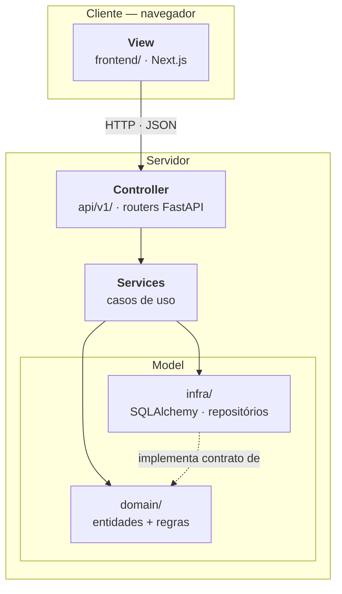

# Arquitetura — Padrão MVC

Este documento registra a decisão arquitetural do projeto e demonstra como
o padrão **MVC** (*Model-View-Controller*) foi aplicado.

---

## 1. O ponto de partida

A disciplina indica MVC como padrão de projeto para o back-end. A
aplicação segue MVC, com uma adaptação necessária e uma extensão
deliberada, ambas justificadas abaixo.

## 2. Por que MVC não é literal em arquitetura desacoplada

O MVC clássico — Smalltalk-80, e depois Django, Rails, Laravel, Spring MVC
— pressupõe que **o servidor renderiza a View**. Os três componentes vivem
no mesmo processo: o Controller recebe a requisição, consulta o Model e
escolhe qual template renderizar.

Quando a aplicação é dividida em SPA (*Single Page Application*) + API
REST, essa premissa deixa de valer:

- A **View** migra inteira para o cliente, como aplicação autônoma
- O **Controller** passa a responder com dados (JSON), não com HTML renderizado
- O **Model** permanece no servidor

O resultado não é "MVC abandonado". É **MVC distribuído pela rede** — os
três papéis continuam existindo e com as mesmas responsabilidades, apenas
separados por uma fronteira HTTP.

## 3. O mapeamento

| Componente MVC | Onde vive | Responsabilidade |
|---|---|---|
| **View** | `frontend/` (Next.js) | Apresentação, captura de entrada do usuário |
| **Controller** | `backend/app/api/v1/` | Recebe requisição, valida entrada, invoca o Model, devolve resposta |
| **Model** | `backend/app/domain/` + `backend/app/infra/` | Dados e regras de negócio |
| *(extensão)* | `backend/app/services/` | Casos de uso — orquestra Controller e Model |



## 4. Por que existe a camada `services/`

MVC tem um modo de falha documentado e recorrente: o **fat controller**.
Como o Controller é o único ponto de entrada, a lógica de negócio tende a
se acumular nele. O sintoma é um método de controlador com 200 linhas que
valida, consulta banco, aplica regra, calcula e monta resposta — impossível
de testar sem subir a aplicação inteira.

O contra-sintoma é o **anemic model**: entidades reduzidas a sacos de
atributos, sem comportamento, porque todo o comportamento foi para o
controlador.

A camada de serviços é a solução clássica para ambos. Ela absorve a
orquestração, deixando o Controller com uma única responsabilidade:
traduzir HTTP. Compare:

```python
# Fat controller - o que queremos evitar
@router.post("/carrinho/itens")
def adicionar(payload: dict, db: Session = Depends(get_db)):
    cupcake = db.query(CupcakeModel).filter_by(id=payload["cupcake_id"]).first()
    if not cupcake:
        raise HTTPException(404, "nao encontrado")
    if not cupcake.disponivel:
        raise HTTPException(409, "indisponivel")
    if payload["quantidade"] < 1:
        raise HTTPException(422, "quantidade invalida")
    item = db.query(ItemModel).filter_by(...).first()
    if item:
        item.quantidade += payload["quantidade"]
    else:
        db.add(ItemModel(...))
    db.commit()
    return {"total": sum(...)}
```

```python
# Controller magro - o que o projeto faz
@router.post("/carrinho/itens")
def adicionar(payload: AdicionarItemRequest, servico: CarrinhoService = Depends()):
    carrinho = servico.adicionar_item(
        usuario_id=payload.usuario_id,
        cupcake_id=payload.cupcake_id,
        quantidade=payload.quantidade,
    )
    return CarrinhoResponse.from_domain(carrinho)
```

As regras (quantidade mínima, indisponibilidade, item repetido somar em vez
de duplicar) vivem no Model, em `domain/entities.py`. O Controller não as
conhece.

## 5. O Model não conhece framework

`backend/app/domain/` não importa FastAPI, não importa SQLAlchemy, não
importa Pydantic. É Python puro.

Isso é **DIP** (*Dependency Inversion Principle*, o "D" de SOLID): módulos
de alto nível não dependem de detalhes de infraestrutura. `infra/`
implementa contratos definidos por `domain/`, e não o contrário — é o que
a seta tracejada do diagrama representa.

**Consequência verificável:** os testes do Model rodam sem banco e sem
servidor.

```
$ pytest -v
11 passed in 0.03s
```

Se fosse preciso subir PostgreSQL para testar "quantidade mínima é 1", a
regra estaria na camada errada. O tempo de execução é o teste da
arquitetura, não apenas do código.

## 6. Fluxo completo de uma requisição

Adicionar um cupcake ao carrinho — história ID 05:

| # | Camada | Ação |
|---|---|---|
| 1 | **View** | Usuário clica "Adicionar"; Next.js envia `POST /api/v1/carrinho/itens` |
| 2 | **Controller** | Router recebe, valida o formato do payload via Pydantic |
| 3 | **Service** | `CarrinhoService.adicionar_item()` carrega o carrinho pelo repositório |
| 4 | **Model** | `Carrinho.adicionar()` aplica RN-01, RN-02 e RN-06 |
| 5 | **Model** | `infra/` persiste o estado |
| 6 | **Controller** | Serializa o carrinho para JSON |
| 7 | **View** | Atualiza o contador e o total na tela |

Se o Model levantar `QuantidadeInvalidaError`, o `exception_handler`
registrado em `main.py` converte para HTTP 422 — sem `try/except` espalhado
pelos controllers:

```python
_STATUS_POR_ERRO: dict[type[DomainError], int] = {
    QuantidadeInvalidaError: 422,
    CupcakeIndisponivelError: 409,
    ItemNaoEncontradoError: 404,
    CarrinhoVazioError: 422,
    TransicaoStatusInvalidaError: 409,
}
```

Tabela em vez de `if/elif`: adicionar um erro novo é uma linha, e fica
explícito na revisão de código qual contrato HTTP mudou.

## 7. Testabilidade por camada

| Camada | Como se testa | Precisa de infraestrutura? |
|---|---|---|
| Model (`domain/`) | pytest, instanciação direta | Não |
| Service | pytest com repositório em memória | Não |
| Controller | `TestClient` do FastAPI | Não (banco em memória) |
| View | build do Next.js | Não |

A pirâmide de testes fica correta por construção: muitos testes rápidos na
base, poucos e lentos no topo.

## 8. Resumo da decisão

| Aspecto | Decisão |
|---|---|
| Padrão | MVC, com View no cliente e Model+Controller no servidor |
| Extensão | Camada de serviços, para evitar *fat controller* e *anemic model* |
| Model | Python puro, sem dependência de framework (DIP) |
| Tratamento de erro | Centralizado, por tabela de mapeamento |
| Verificação | 11 testes de regra de negócio em 0,03s, sem infraestrutura |
